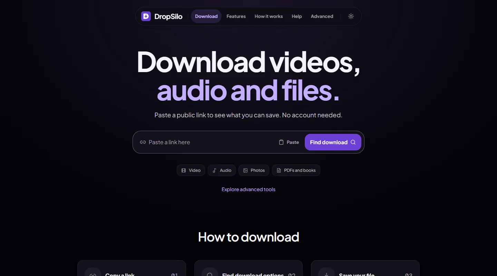

# DropSilo

DropSilo is a browser tool for saving videos, audio, photo galleries, and direct files from public links. Paste a link, choose an available format, and follow the download progress. You can stop an active video download from the progress panel.

[See the mobile layout](docs/images/dropsilo-mobile.webp) · [Engine setup](backend/bin/README.md) · [Advanced downloads](docs/advanced-downloads.md)

## Run locally

Use Node.js 24, npm, [yt-dlp](https://github.com/yt-dlp/yt-dlp), and [FFmpeg](https://ffmpeg.org/download.html). Install the executables on your PATH or point the backend at them with the documented environment variables. The default in-memory queue runs without Redis.

Start the API from the project root in PowerShell.

~~~powershell
cd backend
npm ci
$env:HOST = '127.0.0.1'
npm run dev
~~~

On macOS or Linux, use `HOST=127.0.0.1 npm run dev` in place of the last two lines. The API listens on port 3002.

Start the website in a second terminal from the project root.

~~~sh
cd frontend
npm ci
npm run dev -- --hostname 127.0.0.1 --port 3210
~~~

Open [DropSilo](http://127.0.0.1:3210/) and check the server at [Service status](http://127.0.0.1:3210/status). Next.js proxies `/api` requests to the local backend by default. If you run the API elsewhere, set `NEXT_PUBLIC_BACKEND_URL` for the frontend and allow the frontend origin in the backend's `ALLOWED_ORIGINS`.

## Project layout

| Directory | Purpose |
| --- | --- |
| [frontend](frontend/) | Next.js site, link input, format picker, and live progress |
| [backend](backend/) | Fastify API, download workers, and file delivery |
| [docs](docs/) | Advanced tools, monitoring dashboard, and screenshots |

The API checks links and starts a download job. Workers use yt-dlp and FFmpeg for supported media, and the browser receives progress through server-sent events. Large downloads are staged in the backend's temporary directory, which you can set with `TEMP_DIR`. The [backend environment example](backend/.env.example) documents configuration. A production backend requires its own `FILE_TOKEN_SECRET` to sign file download links.

## Checks

~~~sh
cd backend
npm run typecheck
node --import tsx --test src/__tests__/download-progress.test.ts src/__tests__/source-routing.test.ts src/__tests__/advanced-engines.test.ts

cd ../frontend
npm run typecheck
npm run build
~~~

Only download files you have permission to save.

DropSilo is available under the [MIT License](LICENSE).
